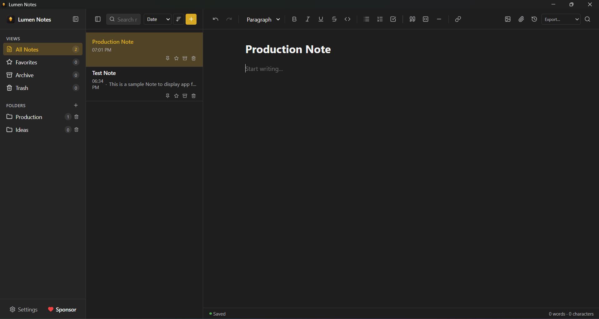
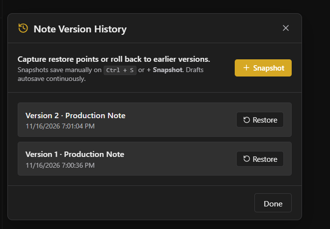
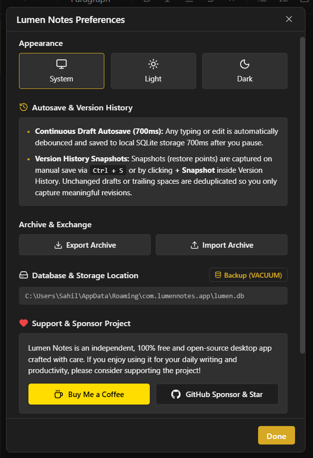
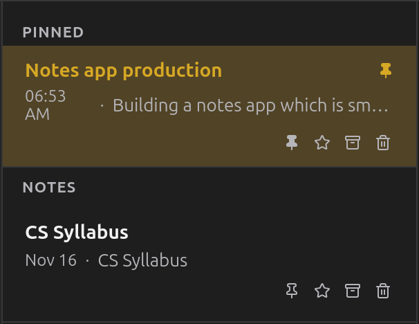

# Lumen Notes

A polished, offline-first desktop notes application built with Tauri v2, Rust 2024, React 19, TypeScript (strict checking), and local SQLite. Features a macOS Notes–style three-pane interface and direct rich-text editing powered by Tiptap/ProseMirror.

<p align="center">
  
</p>

---

## Screenshots

<div align="center">

| Version History & Snapshots | Preferences & Support |
|:---:|:---:|
|  |  |

| Instant Note Pinning with Visual Section Headers |
|:---:|
|  |

</div>

---

## Key Features

- **Offline-First & Fully Private**:
  Zero cloud accounts, telemetry, tracking, or remote font/asset requests. All documents and attachments reside strictly on your local computer.
- **Direct Rich-Text Editing**:
  Single-instance Tiptap 3 / ProseMirror editor. Full formatting support: Paragraphs, Headings (H1–H3), Bold, Italic, Underline, Strikethrough, Bulleted Lists, Numbered Lists, Task Lists (Checklists with persistent state), Blockquotes, Code Blocks, Horizontal Rules, and safe validated external Links.
- **Mac-Style Three-Pane Workspace**:
  Sidebar, Searchable Notes List, and Writing Canvas. Clean typography tokens, independent scrolling, resizable panes persisted across sessions, and responsive mobile/tablet layouts.
- **Reliable Persistence & Autosave**:
  Local SQLite database with WAL mode, foreign keys, and versioned schema migrations. Autosave debounces at 700ms with monotonic revision conflict protection (`expected_revision`), preventing data loss or out-of-order overwrite.
- **Organization & Local Search**:
  Hierarchical folders with cycle prevention, tags, note pinning, favorites, archive, and trash view with restore and permanent deletion. Real-time indexed search across note titles and extracted plain text.
- **Scoped Managed Attachments**:
  File and image attachments stored safely in the platform AppData directory (`attachments/<uuid>.<ext>`) with SHA-256 integrity verification, 25MB size guards, and image thumbnail preview.
- **Exchange & Export**:
  Export active notes as plain text (`.txt`), standalone styled HTML (`.html`), or JSON (`.json`). Export and import full database archives (`lumen-notes-archive`) with pre-import duplicate collision inspection and resolution strategies (`keep_both`, `skip`, `overwrite`).
- **Recovery & Snapshots**:
  Version snapshot history with rollback, automatic emergency local crash recovery drafts on unexpected termination, and transactionally consistent SQLite `VACUUM INTO` snapshots.

---

## Tech Stack

- **Desktop Framework**: Tauri v2
- **Backend**: Rust 2024, `rusqlite` with bundled SQLite 3.49+
- **Frontend**: React 19, TypeScript (strict), Vite, Lucide React (bundled SVG icons)
- **Editor Engine**: Tiptap 3 / ProseMirror
- **Styles**: Plain CSS with centralized macOS Notes tokens (`tokens.css`)
- **Automated Testing**: Vitest, React Testing Library, Playwright (real browser), Rust unit & integration tests

---

## Data Storage Locations

- **Windows**:
  - Database: `%LOCALAPPDATA%\com.lumennotes.app\lumen.db`
  - Attachments: `%LOCALAPPDATA%\com.lumennotes.app\attachments\`
- **Linux**:
  - Database: `~/.local/share/com.lumennotes.app/lumen.db`
  - Attachments: `~/.local/share/com.lumennotes.app/attachments/`

> **Note on Encryption**: The SQLite database is standard unencrypted SQLite with WAL mode. For hardware-level data protection, operating system full-disk encryption (BitLocker on Windows, LUKS on Linux) is recommended.

---

## Development & Test Commands

```bash
# Install dependencies
npm install

# Type check
npm run typecheck

# Lint check
npm run lint

# Run Vitest unit & component tests
npm run test -- --run

# Run Rust backend checks & tests
cargo fmt --manifest-path src-tauri/Cargo.toml --check
cargo clippy --manifest-path src-tauri/Cargo.toml -- -D warnings
cargo test --manifest-path src-tauri/Cargo.toml

# Run complete Playwright E2E test suite (22 tests)
npm run test:e2e

# Run Tauri desktop app in development
npm run tauri dev

# Build frontend and production desktop installers
npm run build
npx tauri build
```

---

## Release Installers & Artifacts

Pre-built binaries are automatically built by GitHub Actions and available on the [Releases](https://github.com/dhillonsahil/lumen-notes/releases) page:
- **Windows**: `.exe` (NSIS setup installer) and `.msi` (Windows Installer)
- **Linux**: `.deb` (Debian/Ubuntu), `.rpm` (Fedora/RHEL), and `.AppImage` (standalone portable)
- **macOS**: `.dmg` (Universal binary supporting Apple Silicon & Intel)

---

## Documentation Index

- [Architecture Guide](docs/ARCHITECTURE.md): Component layers, IPC contracts, document invariants, and data model.
- [Progress Report](docs/PROGRESS.md): Phase-by-phase implementation and verification matrix.
- [Testing & Quality Gates](docs/TESTING.md): Test commands, regression coverage, and manual test checklist.
- [Privacy & Security](docs/PRIVACY.md): Offline guarantee, zero telemetry, storage details, and CSP.
- [Handoff Document](docs/HANDOFF.md): Build artifacts, verification results, known boundaries, and next steps.
- [Architectural Decisions (ADRs)](docs/DECISIONS.md): Key decisions on SQLite, Tiptap JSON, concurrency, and attachments.
